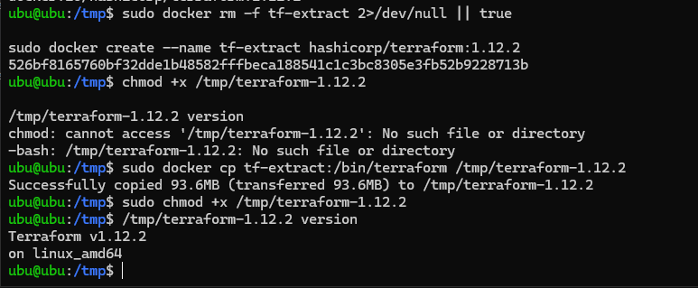
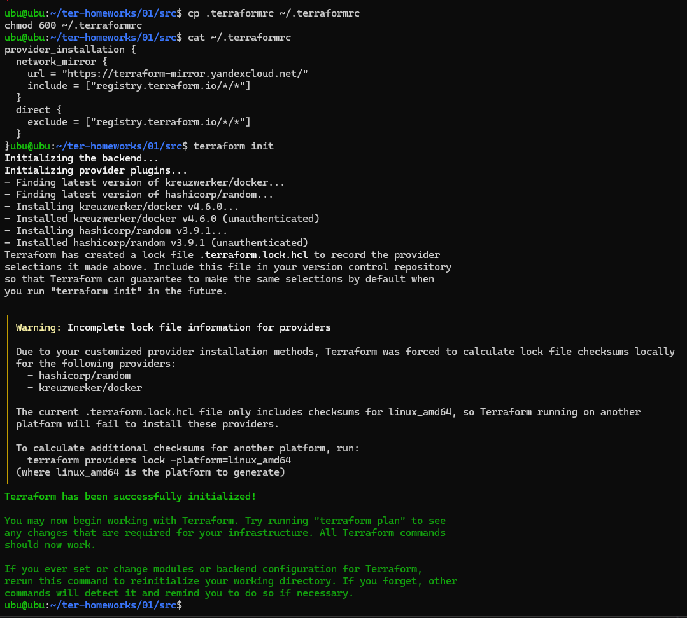
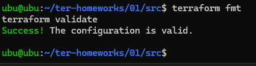
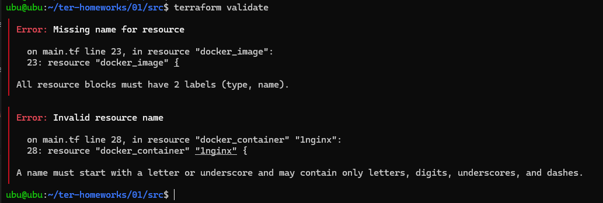
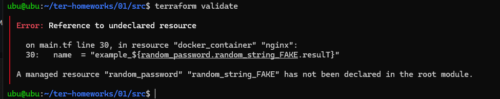
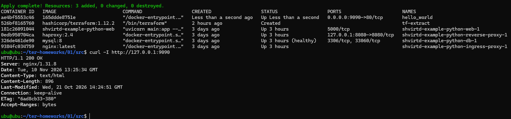
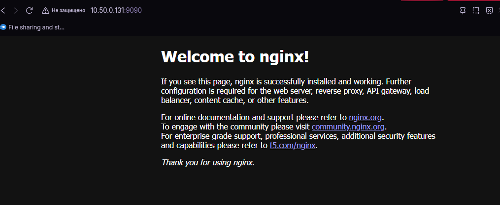
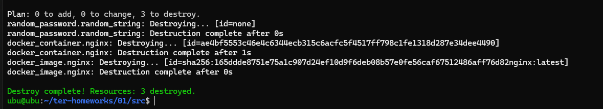
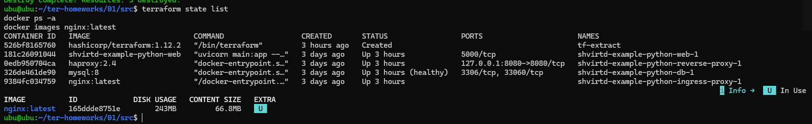

# Домашняя работа: «Введение в Terraform»

## Результат

Обязательная часть выполнена локально, без облачной виртуальной машины. Terraform управлял локальным Docker Engine:

- создан `random_password.random_string`;
- загружен образ `nginx:latest`;
- создан и запущен контейнер `hello_world`;
- порт контейнера `80` опубликован на хосте как `9090`;
- HTTP-проверка вернула `HTTP/1.1 200 OK`;
- `terraform destroy` удалил три Terraform-ресурса;
- после удаления контейнер отсутствует, а образ `nginx:latest` остался локально.

Дополнительное задание со звёздочкой про облачную ВМ необязательное и не выполнялось.

## Окружение

| Компонент | Версия / значение |
|---|---|
| Terraform | `1.12.2` |
| ОС / архитектура | Linux `linux_amd64` |
| Docker provider | `kreuzwerker/docker` `4.6.0` |
| Random provider | `hashicorp/random` `3.9.1` |
| Docker image | `nginx:latest` |
| Container name | `hello_world` |
| Port mapping | `9090:80` |

## Структура

```text
.
├── README.md
├── SECURITY-NOTE.txt
├── 01/
│   └── src/
│       ├── main.tf
│       └── .gitignore
└── screenshots/
```

## Ответы на вопросы

### 1. Подготовка Terraform и Docker

Установлен Terraform `v1.12.2` (`linux_amd64`), Docker установлен и доступен локально. Зависимости инициализированы командой `terraform init`.

### 2. Где хранить личные секреты?

В `.gitignore` есть правило `personal.auto.tfvars`. В этом файле можно хранить личные переменные (пароли, токены, ключи), не добавляя его в Git. Файлы состояния `*.tfstate` и `*.tfstate.*` также исключены из Git, поскольку могут содержать секретные значения.

### 3. Секретное значение `random_password`

У ресурса `random_password.random_string` сгенерированное значение хранится в атрибуте `result` (путь в state: `resources[].instances[].attributes.result`).

**Ключ:** `result`.

**Значение:** секретное случайное значение длиной 16 символов. Оно намеренно не публикуется в открытом GitHub-репозитории. Значение можно было прочитать локально из `terraform.tfstate` до `terraform destroy`. Сам state-файл и пароль не следует коммитить.

### 4. Исправление намеренных ошибок

При проверке исходного раскомментированного блока Terraform обнаружил ошибки:

1. `resource "docker_image" {` — отсутствовала вторая метка (локальное имя ресурса). Исправление: `resource "docker_image" "nginx" {`.
2. `resource "docker_container" "1nginx" {` — имя ресурса начиналось с цифры. Оно исправлено на `nginx`.
3. `random_password.random_string_FAKE.result` — ссылка указывала на несуществующий ресурс. Правильная ссылка: `random_password.random_string.result`.

После исправления `terraform validate` завершился сообщением `Success! The configuration is valid.`

### 5–6. Создание контейнера и флаг `-auto-approve`

Исправленный код находится в [`01/src/main.tf`](01/src/main.tf). Он создаёт контейнер `hello_world` из образа `nginx:latest` и публикует порт `80` контейнера на порт `9090` хоста.

Проверка:

```bash
curl -I http://127.0.0.1:9090
```

Результат:

```text
HTTP/1.1 200 OK
Server: nginx/1.31.8
```

Флаг `-auto-approve` отключает интерактивный запрос подтверждения. Это удобно для автоматизированных CI/CD-процессов и скриптов. Риск в том, что изменения применяются без дополнительного подтверждения человеком: можно случайно создать, изменить или удалить ресурсы. Поэтому перед автоматическим применением нужно проверить `terraform plan`.

### 8. Удаление ресурсов и проверка состояния

Команда `terraform destroy -auto-approve` завершилась сообщением:

```text
Destroy complete! Resources: 3 destroyed.
```

После удаления выполнены `terraform state list`, `docker ps -a` и `docker images nginx:latest`. Список Terraform-ресурсов пуст, контейнер `hello_world` отсутствует, образ `nginx:latest` остался локально.

Файлы `terraform.tfstate` и `terraform.tfstate.backup` не включены в репозиторий: Terraform state может содержать секретные данные, в том числе результат `random_password`. Итоговая проверка приложена в скриншотах.

### 9. Почему образ `nginx:latest` не удалился?

В `main.tf` у ресурса `docker_image.nginx` указано:

```hcl
keep_locally = true
```

Документация Docker provider для `docker_image` говорит: “If true, then the Docker image won't be deleted on destroy operation.” Следовательно, при `terraform destroy` Terraform удалил контейнер и запись ресурса из state, но сохранил сам образ в локальном Docker-хранилище.

Документация: [kreuzwerker/docker — resource `docker_image`](https://library.tf/providers/kreuzwerker/docker/latest/docs/resources/image).

## Как повторить работу

Из каталога `01/src`:

```bash
terraform init
terraform fmt -check
terraform validate
terraform plan
terraform apply -auto-approve
docker ps
curl -I http://127.0.0.1:9090
terraform destroy -auto-approve
terraform state list
docker ps -a
docker images nginx:latest
```

`.terraform.lock.hcl` создаётся командой `terraform init`. После инициализации рекомендуется добавить сгенерированный lock-файл в репозиторий, чтобы зафиксировать версии провайдеров и контрольные суммы. Не добавляйте в Git Terraform state, секретные `.tfvars` или токены.

## Скриншоты

### Версия Terraform



### Инициализация провайдеров



### Успешная проверка конфигурации



### Ошибки исходного блока, найденные при validate





### Запущенный контейнер и HTTP 200 OK



### Страница Nginx в браузере



### Удаление ресурсов Terraform



### Итоговая проверка: state пуст, контейнер удалён, образ сохранён


